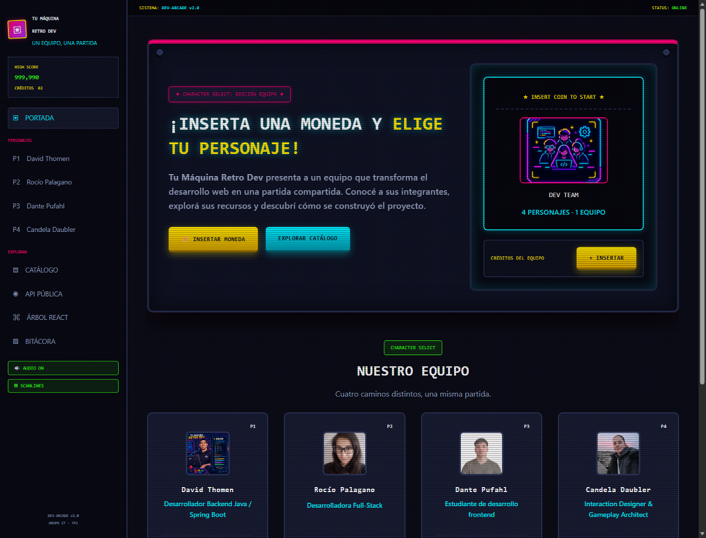
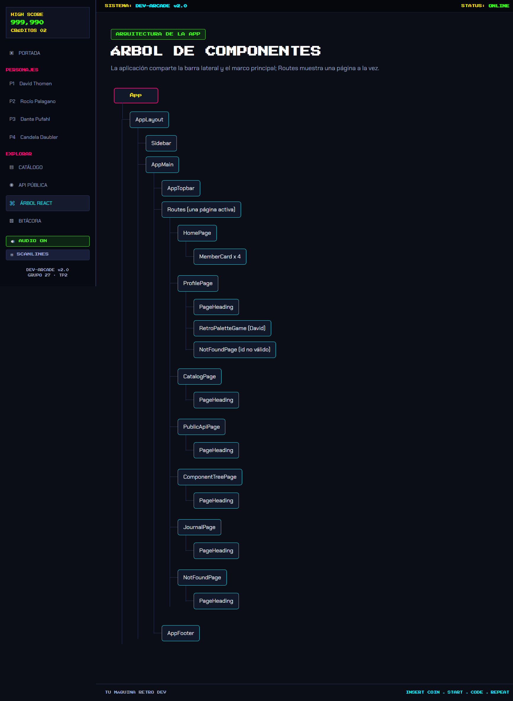

# Tu Máquina Retro Dev · TP2

Aplicación grupal desarrollada en React que continúa el proyecto arcade de TP1. Presenta al equipo y sus perfiles, un catálogo local de recursos con búsqueda y filtro, información de una API pública, el árbol de componentes y la bitácora.

## Índice

- [Proyecto](#proyecto)
- [Capturas](#capturas)
- [Ejecución local](#ejecución-local)
- [Integrantes y responsabilidades](#integrantes-y-responsabilidades)
- [Publicación](#publicación)
- [Declaración de uso de IA](#declaración-de-uso-de-ia)

## Proyecto

La aplicación conserva la identidad visual arcade del equipo y organiza sus secciones mediante una barra lateral compartida. Incluye perfiles individuales, un catálogo leído desde un JSON local, una consulta a la API pública FreeToGame y una bitácora del proceso.

## Capturas

**Portada**



**Árbol de componentes**



## Ejecución local

Requiere Node.js y npm.

```bash
npm install
npm run dev
```

Para generar la versión de publicación:

```bash
npm run build
```

El resultado queda en `dist/`.

## Integrantes y responsabilidades

| Integrante | Perfil | Responsabilidad en el proyecto |
|---|---|---|
| [David Thomen](https://github.com/DavidLG89) | Backend Java / Spring Boot | Diseño de APIs y organización de los contenidos técnicos del catálogo. |
| [Rocío Palagano](https://github.com/RPalagano) | Desarrollo Full-Stack | Integración de datos y revisión del flujo entre interfaz y servicios. |
| [Dante Pufahl](https://github.com/DantePufahl) | Frontend y UX/UI | Componentes React, estilos de interfaz y adaptación visual. |
| [Candela Daubler](https://github.com/CandeDaubler) | Interaction Design & Gameplay | Interacciones y coherencia de la experiencia arcade. |

## Publicación

[Ver la aplicación en Vercel](https://portfolioreact-g27.vercel.app)

## Declaración de uso de IA

Como equipo usamos **GitHub Copilot en Visual Studio Code**, con **Claude** como modelo, para consultar dudas, explorar alternativas, comprender y depurar errores, y revisar propuestas de componentes, estilos y consumo de datos.

| Integrante | Aplicación y modelo | Tareas en las que se usó como apoyo |
|---|---|---|
| David Thomen | GitHub Copilot · Claude | Alternativas para datos, APIs y conceptos de backend. |
| Rocío Palagano | GitHub Copilot · Claude | Dudas de integración full-stack y consumo de datos. |
| Dante Pufahl | GitHub Copilot · Claude | Componentes React, JSX, estilos y experiencia de interfaz. |
| Candela Daubler | GitHub Copilot · Claude | Ideas de interacción, presentación visual y experiencia arcade. |

En esta revisión también se utilizó **OpenAI Codex (GPT-6)** como asistencia para organizar componentes, actualizar los perfiles, rehacer el árbol de componentes y preparar estas capturas y documentación.

Las decisiones, la selección de propuestas y la revisión e integración de los cambios estuvieron a cargo del equipo. La IA fue un recurso de apoyo.
